<div align="center">

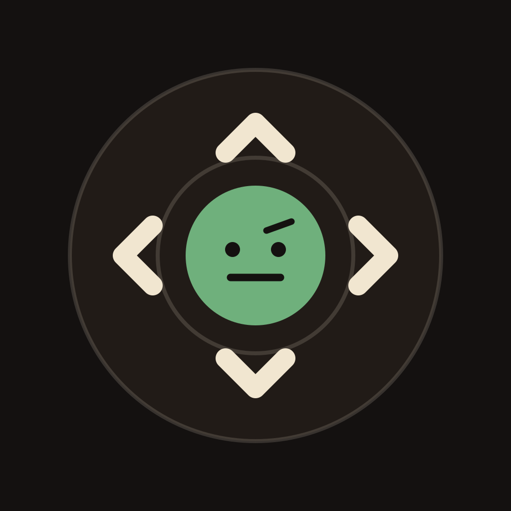

# Quién Manda

**El mando de tu tele en el iPhone y el iPad. Gratis de verdad.**

Sin anuncios, sin rastreo y sin funciones de pago. Para TVs Sony BRAVIA con Android TV o Google TV (2016 en adelante).

[🌐 Web](https://salvatejerosoftwarecompany.es/quienmanda) ·
[📲 App Store (próximamente)](https://salvatejerosoftwarecompany.es/quienmanda) ·
[🗺️ Plan](PLAN.md) ·
[🤝 Contribuir](CONTRIBUTING.md)


</div>

---

## Así funciona

<table>
  <tr>
    <td align="center">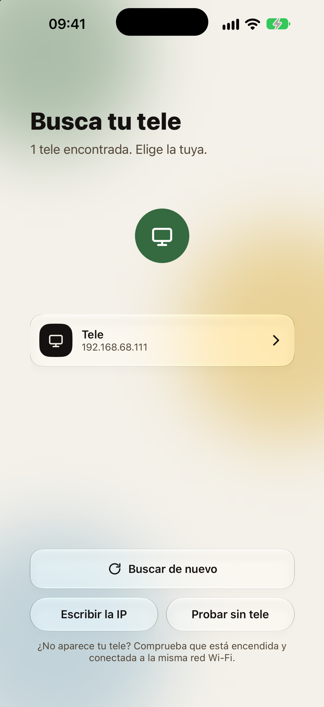<br><b>1. Busca tu tele</b><br><sub>La encuentra sola en tu wifi</sub></td>
    <td align="center">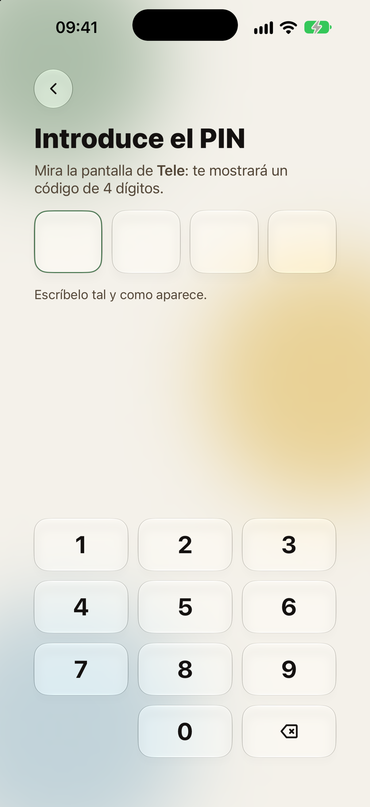<br><b>2. Vincúlala</b><br><sub>Con el PIN que sale en la TV</sub></td>
    <td align="center">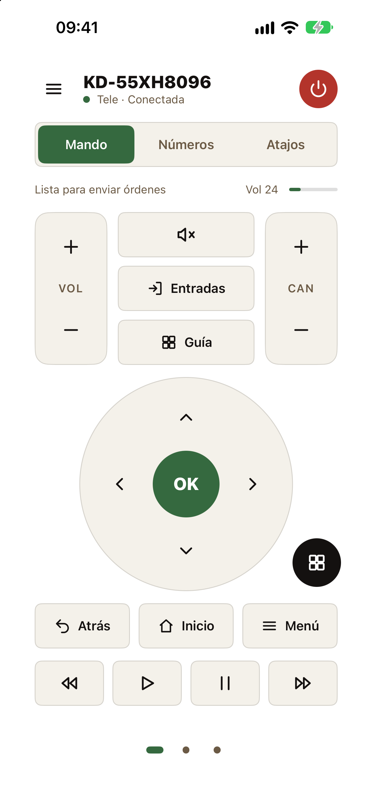<br><b>3. Manda</b><br><sub>Cruceta, volumen, canales y encendido</sub></td>
  </tr>
  <tr>
    <td align="center">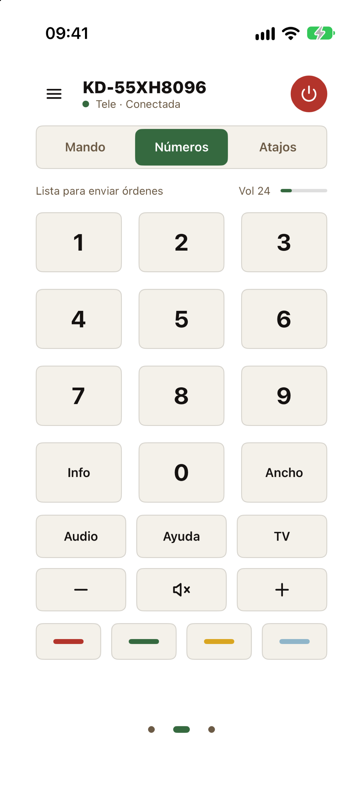<br><b>Números</b><br><sub>Cada tecla va directa a la tele</sub></td>
    <td align="center">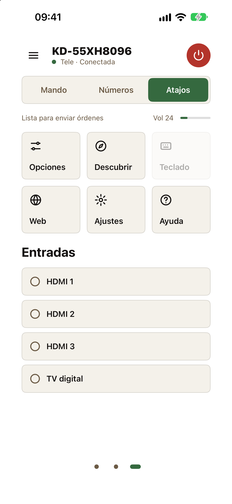<br><b>Atajos</b><br><sub>Entradas HDMI, opciones, ajustes…</sub></td>
    <td align="center">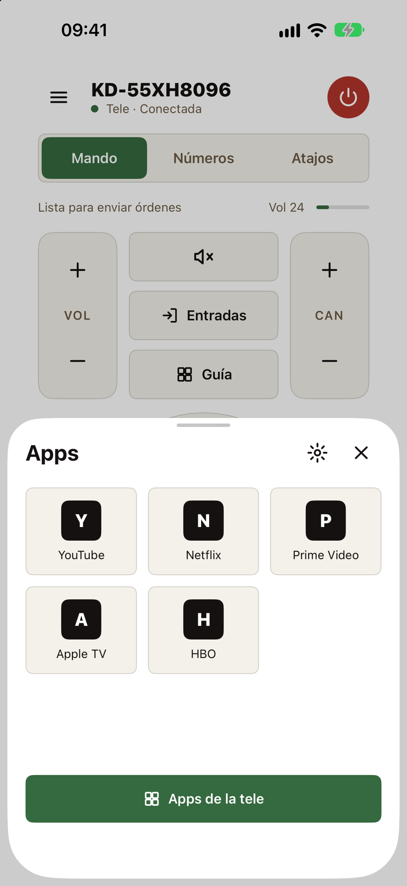<br><b>Apps</b><br><sub>Las que tiene tu TV, en tu orden</sub></td>
  </tr>
</table>

<div align="center">
  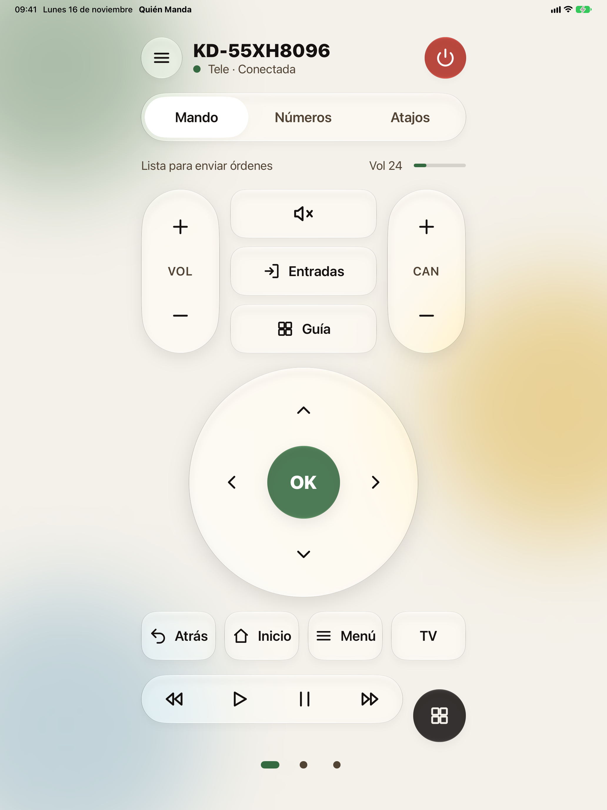
  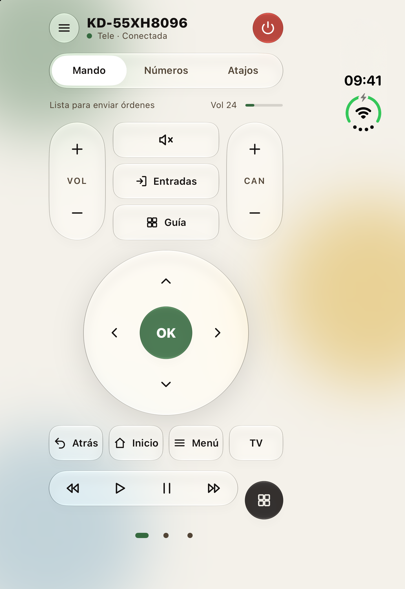
  <br><sub>La misma app en iPad y en pantallas anchas, escalada y a dos columnas.</sub>
</div>

### Lo que tienes gratis (y en otras apps se paga)

- 🔎 **Autodetección** de la tele por Bonjour y barrido de la red, o IP a mano.
- 🔐 **PIN o Pre-Shared Key**, y reconexión directa al abrir la app.
- 📺 **Varias teles guardadas**: cambia, renombra u olvida cada una.
- 🧩 **Panel de apps** con los iconos de tu propia TV, ordenable arrastrando.
- 🌗 **Modo claro y oscuro**, y seis idiomas: español, inglés, portugués, catalán, gallego y euskera.
- ☕ **«Invítame a un café»** opcional, que no desbloquea nada.

Más detalle y novedades en la [web de Quién Manda](https://salvatejerosoftwarecompany.es/quienmanda).

---

## Arquitectura

Unas 1.700 líneas de Swift en cuatro ficheros, **sin dependencias de terceros**: solo `URLSession`,
`Network.framework` y StoreKit 2. Un único target universal para iPhone e iPad.

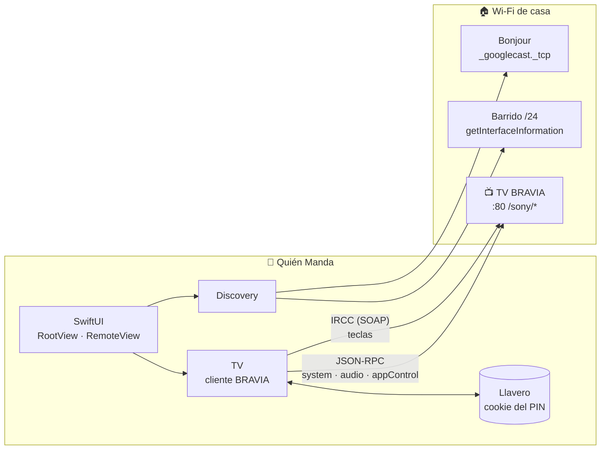

| Fichero | Qué hay |
|---|---|
| [`Sources/TV.swift`](Sources/TV.swift) | Cliente BRAVIA: JSON-RPC `/sony/*`, teclas IRCC por SOAP, autenticación por PSK o PIN (`actRegister` → cookie `auth` en el llavero) y errores traducidos a lenguaje de personas. |
| [`Sources/Discovery.swift`](Sources/Discovery.swift) | Búsqueda de teles: `NWBrowser` con Bonjour y barrido de la subred, confirmando cada IP con `getInterfaceInformation`. |
| [`Sources/App.swift`](Sources/App.swift) | `RootView` (splash, búsqueda, PIN y teles guardadas), estilos de la marca y toasts de error. |
| [`Sources/Remote.swift`](Sources/Remote.swift) | `RemoteView` con sus páginas (Mando, Números y Atajos), el panel de apps, Configuración y el café con StoreKit 2. |
| [`Tests/`](Tests) | XCTest de la lógica sin red: parseo de códigos, SOAP, cookie, volumen, apps y subredes. |

### Cómo habla con la tele

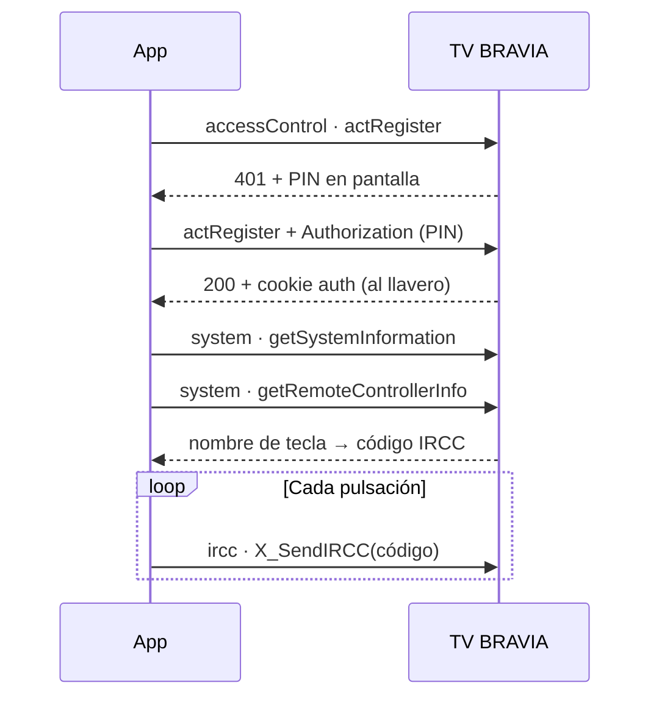

Los códigos IRCC no se escriben en el código: se leen de cada TV, porque cambian según el modelo.
La referencia completa del protocolo está en la skill [`bravia-api`](.claude/skills/bravia-api/SKILL.md).

---

## Compilar y probar

Hace falta Xcode 27 o posterior y [xcodegen](https://github.com/yonaskolb/XcodeGen) (`brew install xcodegen`).

```sh
xcodegen generate
open QuienManda.xcodeproj          # o, desde la terminal:
xcodebuild test -project QuienManda.xcodeproj -scheme QuienManda \
  -destination 'platform=iOS Simulator,name=iPhone Air'
```

**Sin tele a mano** hay un modo demo: lanza la app con `-screen remote|pin|discover`. En
`remote` se puede añadir `-page 0…2`, `-sheet apps|settings` o `-fail <código>` para ver un error,
y en `discover`, `-sheet tvs`.

**En la tele**, activa **Ajustes → Red → Red doméstica → Control IP → Autenticación** con
«Normal y clave precompartida», o solo «Normal» para usar el PIN. La TV y el iPhone tienen que
estar en la misma wifi.

---

## Cómo se ha hecho

Quién Manda se ha desarrollado de principio a fin con **[Claude Code](https://claude.com/claude-code)**,
con una persona que decide y revisa, y varios modelos que programan según lo difícil que sea cada tarea.

### Método

- **Plan antes que código.** [`PLAN.md`](PLAN.md) fija qué se hace, en qué fase y con qué modelo,
  y [`CLAUDE.md`](CLAUDE.md) recoge las reglas que todos los agentes siguen: SwiftUI, sin
  dependencias, sin "Sony" en el nombre visible y textos siempre en el catálogo de idiomas.
- **Lo más simple que funcione.** Cuatro ficheros, sin capas ni abstracciones de más. Cada
  lógica no trivial lleva un test pequeño, y la interfaz se prueba a mano en el simulador y
  con una tele real.
- **Git flow.** `main` para las versiones y `develop` para integrar. Cada trabajo va en
  `feature/*`, que se cierra con `merge --no-ff`.
- **Diseño primero.** El prototipo, el icono, la iconografía y la marca se diseñaron antes de
  programar, y están en [`resources/quien-manda`](resources/quien-manda).

### Modelos, agentes y skills

| Pieza | Modelo | Para qué |
|---|---|---|
| Agente principal | Claude Opus 5.5 | Diseño, protocolo de red, bugs de causa desconocida y revisión |
| [`git-ops`](.claude/agents/git-ops.md) | Claude Haiku 5.5 | Todo lo de git: ramas, commits, merges y worktrees, con los mensajes exactos que da el principal |
| [`ios-dev`](.claude/agents/ios-dev.md) | Claude Sonnet 5.5 | Funcionalidades bien especificadas del plan |
| Skill [`bravia-api`](.claude/skills/bravia-api/SKILL.md) | — | Protocolo BRAVIA: endpoints, autenticación, formatos y trampas conocidas. Se carga antes de tocar `TV.swift`. |
| Skill [`build`](.claude/skills/build/SKILL.md) | — | Generar, compilar, pasar los tests, lanzar en el simulador y hacer capturas |
| Simulador de iOS (MCP) | — | Probar la interfaz y sacar las capturas |
| Claude in Chrome | — | Preparar la ficha en App Store Connect |

### Tokens consumidos (aproximación)

Suma de todas las sesiones de Claude Code en este repositorio, del 20 al 23 de octubre de 2026
(12 sesiones y 916 respuestas del modelo):

| Tipo | Tokens |
|---|---:|
| Entrada sin caché | ≈ 1,9 mil |
| Entrada escrita en caché | ≈ 2,0 millones |
| Entrada leída de caché | ≈ 101 millones |
| **Salida** | **≈ 471 mil** |

De la salida, unos 461 mil tokens son de Opus y unos 10 mil de Haiku (los 37 encargos de `git-ops`).
El agente `ios-dev` (Sonnet) acabó sin usarse: con el contexto ya cargado, salía más barato
que el principal hiciera los cambios directamente. Casi toda la entrada sale de la caché: cada
turno vuelve a leer la conversación, y la caché la abarata mucho.

No están incluidas las sesiones de diseño en claude.ai (el prototipo, el icono y la marca).

---

## Estado

| Funcionalidad | Estado |
|---|---|
| Conexión por IP manual + PSK / PIN | ✅ PIN probado con TV real (BRAVIA 4K UR3); PSK incorrecta se detecta al conectar |
| Cruceta, OK, Atrás, Inicio | ✅ MVP |
| Números 0–9 (cada tecla va directa a la tele, sin panel de canal ni «Ir») y botón TV también en Mando | ✅ simulador |
| Volumen ± / silencio / canal ± / entrada | ✅ MVP |
| Encender y apagar (`setPowerStatus`) | ✅ MVP |
| Diseño de iPad (escalado ×1,6) | ✅ MVP |
| Tele que cambia de IP: guarda el `id` de Bonjour y, si falla la conexión, la reencuentra, migra cookie y PSK y reintenta (#31) | 🟡 lógica probada en tests; sin probar con TV real |
| Mantener pulsado repite volumen, canal y cruceta (`buttonRepeatBehavior`, sin apilar órdenes) (#33) | 🟡 lógica probada en tests; sin probar con TV real |
| Teclado de texto: lo que escribes sustituye el campo abierto en la tele (`setTextForm` 1.0, texto plano; Intro = OK) (#34) | 🟡 interfaz probada en simulador; sin probar con TV real |
| Rediseño Liquid Glass con la marca (Papel / Sótano): `glassEffect` en iOS 26+, material + borde + sombra en iOS 17-18, color plano con «Reducir transparencia» (#32) | 🟡 capturas en simulador (iOS 26.5 y 17.5, claro y oscuro); sin probar en iPad ni en TV real |
| Dynamic Type (hasta accesibilidad 2, textos y alturas que crecen, scroll si no cabe), repaso de VoiceOver (etiquetas, valores, VOL/CAN ajustables) y contraste WCAG del texto mudo (#35) | 🟡 capturas en simulador (iPhone Air y SE); sin probar con VoiceOver en un iPhone real |
| Autodetección: Bonjour `_googlecast._tcp` + barrido de la subred /24 | ✅ probada con TV real (encontró "Tele") |
| UI del arquetipo: páginas Mando/Números/Atajos, panel de Apps, Configuración, «Busca tu tele» y PIN, colores de la marca (claro/oscuro) | ✅ probada con TV real |
| Panel de Apps con las apps instaladas en la TV (icono de la propia TV, ordenar arrastrando) | ✅ probado con TV real |
| Dos columnas en pantalla ancha (iPhone Duo abierto, iPad horizontal) | ✅ simulador |
| Modo demo sin TV (`-screen`, `-page`, `-sheet`, `-fail <código>`) | ✅ |
| Errores en un toast que sube desde abajo, con texto claro en vez del código (401, 40005, sin red…) | ✅ simulador |
| Identidad: icono (oscuro y tintado), splash y 27 iconos propios de `resources/quien-manda` | ✅ simulador |
| Varias teles guardadas: «Mis teles» (icono ☰ en «Busca tu tele») para cambiar, renombrar u olvidar (borra IP, PSK y cookie del llavero) | ✅ simulador; falta probar con TV real |
| Bug: tras un rato en segundo plano las teclas fallaban («La tele no responde» / «no admite esta orden»). Se reintenta una vez si la conexión keep-alive llega muerta (-1005); fallos de red en el log (`category:tv`) | ✅ probado con TV real |
| Reconexión directa al mando con la cookie del PIN guardada en el llavero | 🧪 falta probar con TV real |
| Búsqueda por SSDP | ❌ descartada: necesita el entitlement de multicast y Bonjour + barrido ya lo cubren |
| Hoja de ruta tras la 1.0: arreglos de la 1.0.1, mejoras de la 1.1, lo nuevo y el rediseño Liquid Glass | ⏳ [PLAN.md §7](PLAN.md) |
| TouchPad, teclado de texto, háptica configurable | ⏳ fase 2 |
| Historial, reconexión, Force Mode, onboarding | ⏳ fase 3 |
| Function Keys, Shortcuts de apps, estado de la TV | ⏳ fase 4 |
| Siri / App Intents, widgets, Centro de Control | ⏳ fase 6 |
| Apple Watch | ⏳ fase 7 |
| Modo oscuro (sigue al sistema) | ✅ |
| "Invítame a un café": 3 consumibles StoreKit 2 en Configuración (`Tests/Cafe.storekit` para probar en local) | ✅ simulador; faltan los productos en App Store Connect |
| Temas | ⏳ fase 8 |
| Idiomas | ✅ es, en, pt, ca, gl, eu (String Catalog) |
| README para GitHub: capturas, enlaces a la web, arquitectura, método de desarrollo y tokens | ✅ |

El plan completo está en [PLAN.md](PLAN.md).

---

## Privacidad

La app solo habla con tu TV, dentro de tu red local. No recoge ningún dato, no lleva SDKs de
anuncios ni de analítica, y en la App Store figura como «Datos no recopilados».

## Licencia

El código es software libre bajo la [GNU GPL v3](LICENSE): puedes usarlo, estudiarlo,
modificarlo y redistribuirlo, siempre que lo que distribuyas lleve también la GPL v3
y su código fuente.

**La marca queda fuera de la licencia.** El nombre «Quién Manda», el icono, el splash y
todo lo que hay en `resources/quien-manda` y en `Sources/Assets.xcassets` son
© Salva Tejero Software Company, con todos los derechos reservados. Si publicas una
versión propia, tiene que llevar otro nombre y otro icono.

Para contribuir hay que aceptar el acuerdo de contribución (CLA) de [`CONTRIBUTING.md`](CONTRIBUTING.md).

Sony y BRAVIA son marcas de Sony Group Corporation. Este proyecto no está afiliado
a Sony ni cuenta con su respaldo.

<div align="center"><sub>Hecho con ☕ por <a href="https://salvatejerosoftwarecompany.es/quienmanda">Salva Tejero Software Company</a></sub></div>
